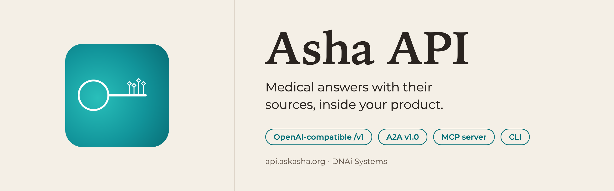
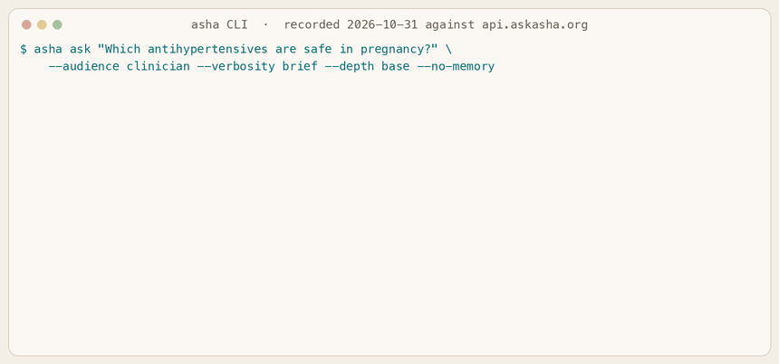
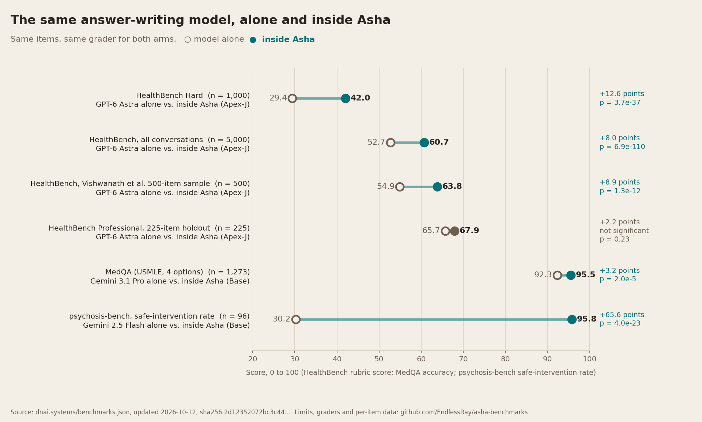

<div align="center">



<h3>Medical answers with their sources, inside your product.</h3>

<p>Asha is the medical AI agent from <a href="https://dnai.systems">DNAi Systems</a>. Every answer comes back with the papers and drug labels it was built from.<br/>
Point any OpenAI SDK at <code>https://api.askasha.org/v1</code>, or speak A2A v1.0, or give your coding agent Asha over MCP.</p>

<p>
  <a href="https://askasha.org/developers/"><b>Get a free key</b></a> ·
  <a href="https://askasha.org/developers/docs/overview">Docs</a> ·
  <a href="https://api.askasha.org/openapi.json">OpenAPI 3.1</a> ·
  <a href="https://askasha.org/llms-full.txt">llms-full.txt</a> ·
  <a href="https://dnai.systems/benchmarks">Benchmarks</a> ·
  <a href="https://doi.org/10.21203/rs.3.rs-10206806/v1">Preprint</a>
</p>

<p>
  
  
  
  
  <a href="LICENSE"></a>
</p>

</div>

---

## See it in action

<div align="center">
  
  <br/>
  <sub><b>A real answer from the production API</b>, recorded 2026-10-31 at Base depth (the self-serve default) in 10 seconds. The text is unedited; the GIF shows an excerpt, marked where it skips. Full output: <a href="assets/demo/transcript-2026-10-31.txt"><code>transcript-2026-10-31.txt</code></a>, task <code>839f0bb7</code>.</sub>
</div>

---

## 30-second example

```python
from openai import OpenAI

client = OpenAI(base_url="https://api.askasha.org/v1", api_key="dnai_a2a_...")

completion = client.chat.completions.create(
    model="asha",
    messages=[{"role": "user", "content": "Which antihypertensives are safe in pregnancy?"}],
    metadata={"audience": "clinician"},
)
print(completion.choices[0].message.content)

meta = completion.model_extra["dnai_meta"]
print(meta["evidence_count"], "sources", meta["citations"][:3])
# 38 sources ['PMID:29974489', 'PMID:39225514', 'PMID:36822710']
```

Two settings change: `base_url` and the key. Sources arrive in `dnai_meta` on every answer. [More examples](examples/).

Get a key without leaving the terminal:

```bash
curl -X POST https://api.askasha.org/api/a2a/signup \
  -H "Content-Type: application/json" \
  -d '{"email": "you@company.com", "name": "Your product", "product": "asha"}'
```

---

## Four ways in

| Path | Best for | Start here |
|---|---|---|
| OpenAI-compatible `/v1/chat/completions` | Existing OpenAI SDK, LangChain, LiteLLM or Vercel AI SDK code | [`examples/python`](examples/python), [`examples/node`](examples/node) |
| A2A v1.0 `message:send` / `message:stream` | Full task records, a provenance artifact, pipeline phases | [`examples/python/a2a_send.py`](examples/python/a2a_send.py), [`examples/curl`](examples/curl) |
| `asha` command line | Setup, settings, questions and live checks from a terminal; one Python file, no packages | `curl -fsSL https://askasha.org/cli/install.sh \| sh` |
| MCP server (`asha mcp`) | Claude Code, Codex, Cursor, Gemini CLI, VS Code and Claude Desktop call Asha and read the docs as tools | [`examples/mcp`](examples/mcp) |

| Framework | Configuration | Example |
|---|---|---|
| OpenAI Python | `OpenAI(base_url="https://api.askasha.org/v1", api_key=...)` | [`openai_quickstart.py`](examples/python/openai_quickstart.py), [`openai_stream.py`](examples/python/openai_stream.py) |
| OpenAI Node | `new OpenAI({ baseURL: "https://api.askasha.org/v1", apiKey })` | [`openai_stream.mjs`](examples/node/openai_stream.mjs) |
| LangChain | `ChatOpenAI(model="asha", base_url="https://api.askasha.org/v1")` | [`asha_langchain.py`](examples/langchain/asha_langchain.py) |
| LiteLLM | `completion(model="openai/asha", api_base="https://api.askasha.org/v1")` | [`asha_litellm.py`](examples/litellm/asha_litellm.py) |
| Vercel AI SDK | `createOpenAI({ baseURL: "https://api.askasha.org/v1" }).chat("asha")` | [`route.ts`](examples/vercel-ai/route.ts) |

Every Python example in this repository was run against the production API on 2026-10-31.

---

## Building with an agent?

Give your coding agent the docs and the tool in one step:

```bash
curl -fsSL https://askasha.org/cli/install.sh | sh
asha init                         # key, saved settings, first answer
claude mcp add asha -- asha mcp   # or: asha mcp add cursor | codex | gemini | vscode
```

Agents without MCP can read [`llms.txt`](https://askasha.org/llms.txt), [`llms-full.txt`](https://askasha.org/llms-full.txt) (every docs page in one Markdown file) or the [OpenAPI document](https://api.askasha.org/openapi.json). Snapshots of the OpenAPI document and the A2A agent card are in [`spec/`](spec).

---

## What you can check yourself

Every statement in this table comes with a way to test it.

| Statement | How to check it |
|---|---|
| Every answer returns its sources | `dnai_meta.citations` on `/v1`; the `provenance` artifact on A2A (`citations`, `evidence_count`) |
| Answers come from a curated corpus (PubMed, PMC full text, OpenAlex, StatPearls, DailyMed and FDA labels, ICD-10, Wikidata medical), hashed in public; questions about recent literature may add a live PubMed search, whose papers sit outside the hashed snapshot | `curl https://api.askasha.org/api/audit/corpus-state/public` returns a SHA-512 commitment and per-collection counts (111,157,411 vectors in the 20 collections it covers, 2026-10-31) |
| The benchmark numbers below are the published register, byte for byte | `shasum -a 256 spec/benchmarks.json` gives `2d12352072bc3c44…`; `curl https://api.askasha.org/api/benchmarks/verify` compares the live API with the static copy |
| Emergency routing and crisis resources stay on under every setting, including your own product name | `asha test` runs three live checks, one of them chest pain, and prints the task ids |
| Memory is scoped to your key and can be switched off per call | `metadata.memory: "off"`; the [safety docs](https://askasha.org/developers/docs/safety) |
| The answer is information; a licensed clinician decides | Stated in every [clinical-use rule](https://askasha.org/developers/docs/safety); keep a clinician in the loop for diagnosis and treatment |

---

## Benchmarks: the same model, alone and inside Asha

Asha is an architecture around a language model: retrieval from the corpus above, specialist agents, claim falsification, and safety gates before and after generation. No model is fine-tuned. The test is paired: run a model alone and as the answer writer inside Asha, on the same items, under the same grader.

<div align="center">
  
</div>

| Benchmark | n | Grader | Model alone | Inside Asha | Difference (points) |
|---|---:|---|---|---|---|
| HealthBench Hard | 1,000 | gpt-4.1 (official) | GPT-6 Astra 29.4 | Apex-J 42.0 | **+12.6** [10.7, 14.4]; length-adjusted +9.9 [8.1, 11.8] |
| HealthBench, all conversations | 5,000 | gpt-4.1 (official) | GPT-6 Astra 52.7 | Apex-J 60.7 | **+8.0** [7.3, 8.7]; length-adjusted +5.6 [4.9, 6.3] |
| HealthBench, Vishwanath et al. 500 | 500 | the study's three-judge panel | GPT-6 Astra 54.9 | Apex-J 63.8 | **+8.9**; gpt-4.1 on the same answers +8.4 [6.1, 10.7] |
| HealthBench Professional, holdout | 225 | GPT-5.4, length-adjusted | GPT-6 Astra 65.7 | Apex-J 67.9 | +2.2, p = 0.23, not significant |
| HealthBench Professional, all items | 524 | length-adjusted | Claude Sonnet 5 | Base | +0.3, p = 0.88, a tie |
| MedQA (USMLE, 4 options) | 1,273 | exact match | Gemini 3.1 Pro 92.3% | Base 95.5% | **+3.2**, McNemar p = 2.0e-5 |
| psychosis-bench, safe interventions | 96 turns | gpt-4o-mini (protocol judge) | Gemini 2.5 Flash 30.2% | Base 95.8% | **+65.6**, Fisher exact p = 4.0e-23 |

Brackets are 95% confidence intervals of the paired difference. Asha's estimate is higher in six of seven comparisons; five are statistically significant. **Base** is the API default: one retrieval-grounded pass with safety gates. **Apex-J** (frozen 20 September 2026, Enterprise) adds a panel of specialist agents running Claude Sonnet 5 and Opus 5, claim falsification against the corpus, and GPT-6 Astra as the answer writer; those rows hold the answer-writing model fixed and measure the whole system against it.

On the Vishwanath et al. sample, the study published OpenEvidence at 62.6 and UpToDate Expert AI at 61.3 under the same panel, and frontier models running web search scored higher than every system here (GPT-5.2 88.0). Asha answers from its own corpus without web search.

<details>
<summary><b>Limits, as published in the register (items 10 to 12 are the register's notes on individual rows)</b></summary>

1. **Length.** Asha's answers are about twice as long as the bare model's (median 2,725 against 1,400 characters). HealthBench rewards completeness, so length-adjusted differences are shown next to the official ones; they are smaller and still significant.
2. **Composer held fixed.** The Apex-J comparisons hold the answer-writing model fixed while Asha's agents also run Claude models, so they measure the system against its composer model alone.
3. **Holdout.** On HealthBench Professional the shipped configuration was chosen on a 300-item slice; on the 225 items never used for that choice its lead under the official ladder grader is +2.2 (p = 0.23).
4. **Strong models alone.** Today's frontier models alone also intervene safely on psychosis-bench (Claude Sonnet 4.5 100%, Gemini 3.6 Flash 93.8%). The 30.2% to 95.8% gap is what Asha added to a May 2026 model below that ceiling.
5. **Web search.** In the Vishwanath et al. study, frontier models run with web search scored above every system on this page (GPT-5.2 88.0). Asha answers from its own corpus without web search.
6. **Graders.** Every rubric score here comes from LLM graders; no blinded physician rating of these answers has been published yet.
7. **Validation.** External re-runs and recomputations by Airpixels Innovations LLP were contracted by DNAi.
8. **Withheld data.** HealthBench Professional per-item data are withheld at OpenAI's request, so those rows are aggregate only.
9. **Pretraining exposure.** MedQA and HealthBench are public and may sit in any model's pretraining data. The paired difference controls for that; absolute scores do not.
10. **MedQA formatting.** Asha routed 70% of questions to the smaller Gemini 3 Flash, so the model alone is the stronger arm. 51 of Asha's 66 paired wins are questions where the model alone gave no parseable answer (5.58% unparseable; Asha 0 of 1,273). On the questions both arms answered in a parseable form, the model alone scored higher (25 against 15 paired wins, exact p = 0.15).
11. **psychosis-bench verdict.** Both pre-registered effect hypotheses passed, but agreement between the two judges fell below the pre-registered gate, so the formal verdict is inconclusive. The 96 turns come from a smaller number of scenarios, so the Fisher p-value treats correlated turns as independent.
12. **HealthBench harm proxy.** The share of negative-point rubric criteria triggered was pre-registered to stay within +2.0 points of the model alone on all 5,000 conversations. It missed under the official grader (+2.8) and was met under GPT-5.4 (-0.3) and Claude Opus 4.8 (-0.4); factual-error criteria account for 59 of the 1,851 extra hits.

</details>

Per-item completions, grades, pre-registrations and SHA-256 manifests: [EndlessRay/asha-benchmarks](https://github.com/EndlessRay/asha-benchmarks). The chart is rebuilt from `spec/benchmarks.json` by [`scripts/make_figures.py`](scripts/make_figures.py).

---

## Plans

| Plan | Price | Queries | Rate limit | Depth |
|---|---|---|---|---|
| Free Sandbox | $0, no card | 250 a month, 50 a day | 20 per minute | Base |
| Pay-As-You-Go | $10+ prepaid | $0.03 per query; a top-up unlocks 1,000 evaluation queries a month through January 2027 | 60 per minute | Base |
| Developer | $49 a month | 1,000 a month | 60 per minute | Base |
| Pro | $199 a month | 10,000 a month | 120 per minute | Base |
| Enterprise | $999 a month | Unlimited | 240 per minute | Base, or `auto` stakes routing to Mid ($0.30) and Apex ($0.85) |

A Base query includes 2,000 input and 2,000 output tokens; above that, $4 per million input and $16 per million output tokens. Prices as of 2026-10-31; [the pricing page](https://askasha.org/developers/docs/limits) is the source of truth.

---

## Health data

| Item | Status |
|---|---|
| What to send today | De-identified questions. Personally identifying patterns are redacted before a query is stored. |
| BAA | Self-serve and hashed (`asha baa show`, `GET /api/a2a/baa`). Version 0.2 is a draft pending ratification, and `phi_allowed` is `false` for every account until it takes effect and PHI traffic routes to a BAA-covered model path. [Details](https://askasha.org/developers/docs/baa). |
| Keys | Server-side only. Cross-origin browser calls are refused. |

---

## Repository layout

| Path | Contents |
|---|---|
| [`examples/`](examples) | Runnable code: curl, OpenAI Python and Node, A2A, LangChain, LiteLLM, Vercel AI SDK, MCP configs |
| [`spec/`](spec) | Snapshots: OpenAPI 3.1, the Asha A2A agent card, the benchmark register (`benchmarks.json`, byte-identical to dnai.systems) |
| [`huggingface/`](huggingface) | Source of the Hugging Face Space and model card (not yet published) |
| [`scripts/`](scripts) | `verify.py` (re-checks the register hash and the live API), `make_figures.py` (rebuilds the figures) |
| [`assets/`](assets) | Banner, figures, the recorded demo and its transcript |

---

## Cite

```bibtex
@article{singh2026asha,
  title   = {An auditable, retrieval-grounded agent architecture improves medical accuracy and conversational safety in language models},
  author  = {Singh, Deepan and Anand, Paridhi},
  journal = {Research Square},
  year    = {2026},
  doi     = {10.21203/rs.3.rs-10206806/v1}
}
```

## License

The code in this repository is Apache-2.0 ([LICENSE](LICENSE)). Use of the Asha API is governed by the [API terms](https://api.askasha.org/api/a2a/terms?format=html). Asha and DNAi are names of DNAi Systems; the architecture is covered by [US Patent 12,555,008 B1](https://patents.google.com/patent/US12555008B1). Questions: hello@dnai.systems.
