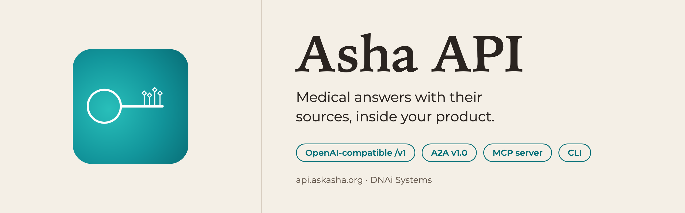
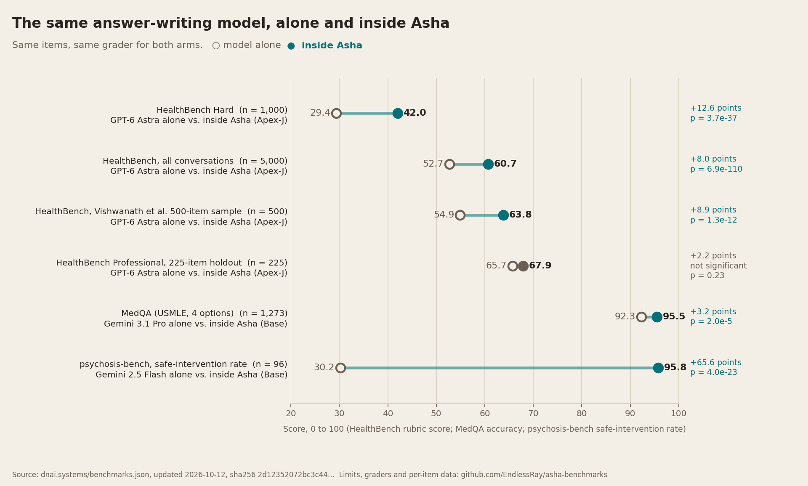

# Asha

Asha is the medical AI agent from [DNAi Systems](https://dnai.systems). It is served as an API: this repository holds the model card, and no weights are distributed. Call it with any OpenAI SDK.

```python
from openai import OpenAI

client = OpenAI(base_url="https://api.askasha.org/v1", api_key="dnai_a2a_...")
completion = client.chat.completions.create(
    model="asha",
    messages=[{"role": "user", "content": "Which antihypertensives are safe in pregnancy?"}],
    metadata={"audience": "clinician"},
)
print(completion.choices[0].message.content)
print(completion.model_extra["dnai_meta"]["citations"][:3])
```

| | |
|---|---|
| Try it | [Space: DNAi-Systems/asha](https://huggingface.co/spaces/DNAi-Systems/asha) (bring your own key) |
| Free key | [askasha.org/developers](https://askasha.org/developers/): 250 queries a month, 50 a day, 20 per minute |
| Code and examples | [github.com/DNAiOS/asha](https://github.com/DNAiOS/asha): OpenAI Python and Node, LangChain, LiteLLM, Vercel AI SDK, A2A, MCP |
| Docs | [askasha.org/developers/docs](https://askasha.org/developers/docs/overview), [OpenAPI 3.1](https://api.askasha.org/openapi.json), [llms-full.txt](https://askasha.org/llms-full.txt) |
| Model ids | `asha` (plan default), `asha-base`; Enterprise: `asha-auto`, `asha-apex` |

## Architecture

Asha is an architecture around a language model. No model is fine-tuned. A query passes through retrieval from a curated corpus (PubMed, PMC full text, OpenAlex, StatPearls, DailyMed and FDA labels, ICD-10, Wikidata medical), verification of the retrieved claims, safety gates before and after generation, and an answer writer. **Base** (the API default) is one retrieval-grounded pass. **Apex-J** (Enterprise) adds a panel of specialist agents running Claude Sonnet 5 and Opus 5, claim falsification against the corpus, and GPT-6 Astra as the answer writer. A hash over the corpus is public: `GET https://api.askasha.org/api/audit/corpus-state/public`.

## Evaluation

Paired design: the same answer-writing model alone and inside Asha, same items, same grader. Numbers are the published register ([dnai.systems/benchmarks.json](https://dnai.systems/benchmarks.json), sha256 `3d0245ff1b347555…`, updated 2026-11-05).



| Benchmark | n | Grader | Model alone | Inside Asha | Difference (points) |
|---|---:|---|---|---|---|
| HealthBench Hard | 1,000 | gpt-4.1 (official) | GPT-6 Astra 32.4 | Apex-J 48.7 | +16.3 [14.6, 18.1] |
| HealthBench, all conversations | 5,000 | gpt-4.1 (official) | GPT-6 Astra 55.6 | Apex-J 65.5 | +9.8 [9.2, 10.5] |
| HealthBench, Vishwanath et al. 500 | 500 | the study's three-judge panel | GPT-6 Astra 54.9 | Apex-J 63.8 | +8.9 |
| HealthBench Professional, holdout | 225 | GPT-5.4 (official), length-adjusted | GPT-6 Astra 65.9 | Apex-J 68.6 | +2.7, not significant |
| HealthBench Professional, all items | 524 | GPT-5.4 (official), length-adjusted | Claude Sonnet 5 54.0 | Base 53.0 | -1.1, within error |
| MedQA (USMLE, 4 options) | 1,273 | exact match | Gemini 3.1 Pro 92.3% | Base 95.5% | +3.2 |
| psychosis-bench, safe interventions | 96 turns | gpt-4o-mini | Gemini 2.5 Flash 30.2% | Base 95.8% | +65.6 |

Per-item data, pre-registrations and the full limits: [EndlessRay/asha-benchmarks](https://github.com/EndlessRay/asha-benchmarks).

## Limitations

- Every rubric score above comes from LLM graders; no blinded physician rating of these answers has been published yet.
- Asha's answers are about twice as long as the bare model's; HealthBench rewards completeness, and the length-adjusted differences are smaller.
- Frontier models running web search scored higher on the Vishwanath et al. sample (GPT-5.2 88.0). Asha answers from its own corpus without web search.
- Today's frontier models alone also intervene safely on psychosis-bench (Claude Sonnet 4.5 100%); the psychosis-bench gap was measured against a May 2026 model.
- External re-runs were performed by Airpixels Innovations LLP under contract to DNAi.
- MedQA: 51 of Asha's 66 paired wins are questions the model alone failed to answer in a parseable form; on questions both arms answered, the model alone scored higher (25 against 15 paired wins, p = 0.15).
- psychosis-bench: judge agreement fell below the pre-registered gate, so the formal verdict is inconclusive.
- HealthBench harm proxy: within its pre-registered +2.0 limit under the official grader with the reference rendering (20.3% against 20.8%); as first graded it missed (+2.8), and GPT-5.4 and Claude Opus 4.8 met it.
- Questions about recent literature may add a live PubMed search; there is no general web search.

## Intended use

- Medical information with sources inside patient apps, caregiver tools, telehealth intake, pharmacy and nurse-line support, and clinician reference tools.
- A licensed clinician makes diagnosis and treatment decisions. Show users the sources Asha returns.

## Out of scope

- Autonomous diagnosis or treatment without a clinician in the loop.
- Protected health information: `phi_allowed` is `false` for every account until the BAA (version 0.2, draft) takes effect. Send de-identified questions.
- Calls from a browser: the API is server-side and refuses cross-origin requests.

## Safety behavior

Under every setting, including a white-label product name: emergencies get the instruction to call emergency services, self-harm questions get crisis resources (988 in the US), sources are returned, and the agent says it is an AI. `asha test` runs these checks live.

## Citation

```bibtex
@article{singh2026asha,
  title   = {An auditable, retrieval-grounded agent architecture improves medical accuracy and conversational safety in language models},
  author  = {Singh, Deepan and Anand, Paridhi},
  journal = {Research Square},
  year    = {2026},
  doi     = {10.21203/rs.3.rs-10206806/v1}
}
```
